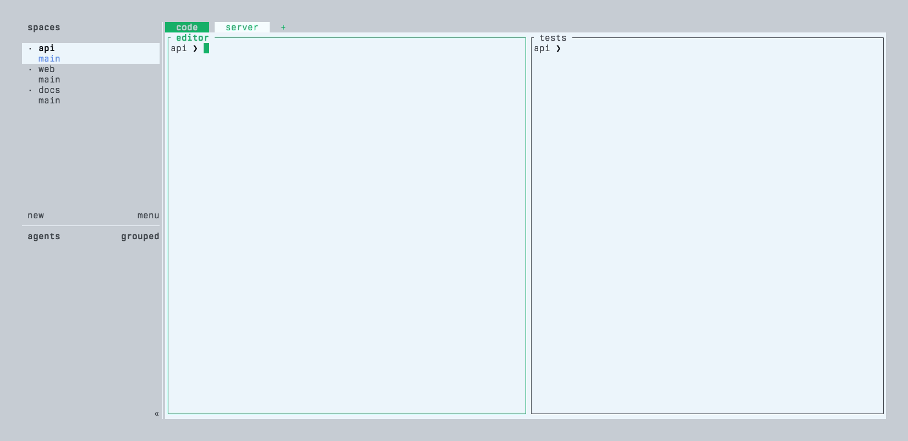

# Helm for Herdr

<p align="center">
  <strong>See which Herdr workspace needs you, and get there in two keys.</strong>
</p>

<p align="center">
  <a href="https://github.com/black-atom-industries/helm.herdr/actions/workflows/ci.yml"></a>
  <a href="https://github.com/black-atom-industries/helm.herdr/releases/latest"></a>
  <a href="LICENSE"></a>
  
  
</p>

<picture>
  <source media="(prefers-color-scheme: dark)" srcset="docs/assets/readme/glance-dark.webp">
  
</picture>

Helm is a popup for Herdr. It lists every open Workspace once, sorted by temperature: agents waiting on you at the top, then the Workspaces you are working in, then the ones that went cold.

1. Press your Helm key.
2. Read the list: who waits, who works, what changed.
3. Press a row's letter twice, or `enter`, to go there.

When the Workspace you want is not open yet, type `/` and its name. Search also covers zoxide directories and your project roots, and Helm creates the Workspace for you.

> [!NOTE]
> Part of the [Helm](https://github.com/black-atom-industries) family, next to [helm.tmux](https://github.com/black-atom-industries/helm.tmux).

## Contents

- [The glance](#the-glance)
  - [Groups](#groups)
  - [Send a Workspace to Cold](#send-a-workspace-to-cold)
  - [Dismiss a done agent](#dismiss-a-done-agent)
  - [Other Herdr sessions](#other-herdr-sessions)
  - [Sessions view](#sessions-view)
  - [Detail pane](#detail-pane)
  - [Search](#search)
- [Install](#install)
- [Reference](#reference)
  - [Keys](#keys)
  - [Configuration](#configuration)
  - [Jump back](#jump-back)
  - [Side pane](#side-pane)
  - [Start Herdr through Helm](#start-herdr-through-helm)
  - [Directory template](#directory-template)
  - [Your own source](#your-own-source)
  - [Subagent progress](#subagent-progress)
- [Troubleshooting](#troubleshooting)
- [Development](#development)
- [Credits](#credits)

## The glance

### Groups

Every open Workspace sits in one group:

| Group     | Holds                                                    |
| --------- | -------------------------------------------------------- |
| Pinned    | Workspaces you pinned with `^B`                          |
| Needs you | An agent that is waiting, blocked or done                |
| Hot       | A working agent, or activity within the last 15 minutes  |
| Warm      | Activity within the last 4 hours                        |
| Cold      | Everything older, and Workspaces you sent there with `c` |

Activity is the newest of three things: when you last focused the Workspace, its last commit, and its agents' last state change. Each row shows how long ago that was, such as `4m`.

A row also shows its agent's state icon, the git branch and its git status: `+n` staged, `!n` modified and `?n` untracked files, `↑n` and `↓n` commits ahead of and behind the upstream, or a green `✓` when the tree is clean and in sync. While an agent works, a bar at the end of the row sums the progress of its subagents. A dim header row at the top of the list names the columns, KEY, ST, WORKSPACE, BRANCH, GIT, AGE and PROGRESS, and stays in place while the rows scroll. The last line of the list is a legend for the state icons: working, waits, done and idle. It shows in the Sessions view too, and a narrow list drops legend entries from the right.

The first five rows get a letter (`a` `s` `d` `f` `g`). Press it once to select the row, twice to open it. Rows hold their place while Helm is open, so the letters don't jump around under you.

### Send a Workspace to Cold

`c` `c` sends the selected Workspace to Cold, and it stays there until something happens in it: you focus it, someone commits, or one of its agents changes state. From then on it sorts by its activity again. The first `c` asks, the second confirms, any other key cancels. A single `c` on a cold Workspace lets it warm up by hand. Use it for a Workspace you are done with for today that would otherwise take a top row.

A cold Workspace still moves up to Needs you when one of its agents waits on you. Pinning a cold Workspace takes it out of Cold.

### Dismiss a done agent

A done agent stays in Needs you until you prompt it again, even after you look at its pane. When you have read its result and there is nothing to answer, `D` dismisses the done agents of the selected Workspace. The row returns to its usual group until an agent there finishes again.

### Other Herdr sessions

Below the Helm line, the popup names the Herdr session it runs in, such as `󰌨 black-atom`, followed by the search. Needs you also lists the Workspaces of your other running Herdr sessions where an agent waits on you. Their other Workspaces stay out of the glance until you search with `*`. An agent that finishes in a session you have left counts as done there, even though Herdr reports it idle, so it shows up here with the done icon. Such a row carries an `@session` tag after its name, and the header counts it in `N need you · M elsewhere`. The detail pane works on it as on any row, and the footer reads `enter switch to <session>`. Opening such a row switches this terminal to that session, at that Workspace (and Tab, with `1`–`9`), when Herdr runs under [`helm-herdr shell`](#start-herdr-through-helm). Otherwise Helm stays open and says in the footer how to switch sessions.

`helm-herdr status` prints one line for Herdr's tab bar: each other session with Workspaces that need you, as `<session> <icon><count>`, with the icon of the most urgent state. It prints nothing when no session waits. With the binary linked onto your `PATH` as in [Install](#install), add it to `~/.config/herdr/config.toml`:

```toml
tab_bar_right = [
  { type = "command", command = "helm-herdr status", interval_seconds = 2, timeout_seconds = 2 },
]
```

### Sessions view

`^S` lists your Herdr sessions, one row each. Running holds the session you are in, then the others by their newest Workspace focus or agent change. Stopped holds the sessions that don't answer, dimmed, with `start` where the count would be. A row shows the session's most urgent agent icon, `N need you` when Workspaces wait on you, its Workspace count, and the age of its newest activity, under the headers KEY, SESSION, WORKSPACES and AGE. Search narrows the rows by session name.

The detail pane shows the selected session's directory and state, then its Workspaces in Needs you, Hot, Warm and Cold, numbered `1`–`9`, then its agents. A stopped session shows `stopped · enter starts it`. `J` and `K` scroll a long detail.

Opening another session switches to it under `helm-herdr shell`: `enter` or the row's letter twice lands on its last focused Workspace, and `1`–`9` on that numbered Workspace. A stopped session starts. Without `helm-herdr shell`, Helm stays open and says in the footer how to switch sessions. On your own session, `enter` returns to the glance and `1`–`9` opens that Workspace.

Under `helm-herdr shell`, `l` switches to another session's Workspace when it was focused more recently than any local one, else opens the previous Workspace. Without `helm-herdr shell`, `l` always opens the previous Workspace. The `jump-back` action stays within the session.

### Detail pane

Beside the list, the detail pane shows the selected Workspace: its Tabs as numbered chips (`1`–`9` opens one), its agents and their running subagents, uncommitted changes, and recent commits. `J` and `K` scroll it. It needs a popup at least 110 columns wide.

### Search

Press `/` and type. The groups stay and the rows narrow in place, with the cursor on the best match. Two more groups join while you search: Directories, for zoxide and root directories, and Other, for Herdr Plus Quick Actions and your own sources.

A few tokens narrow the match:

| Token       | Matches                                       |
| ----------- | --------------------------------------------- |
| `agent`     | Workspaces with an agent. A bare `@` does too |
| `!claude`   | An agent name                                 |
| `@idle`     | Workspace or status text                      |
| `#idle`     | Status text only                              |
| `/dotfiles` | A path                                        |
| `*`         | Workspaces of every running session           |
| `*work`     | Workspaces of sessions named like `work`      |

## Install

Install the plugin. Herdr clones the repository and builds it with Cargo:

```bash
herdr plugin install black-atom-industries/helm.herdr --yes
```

Link the binary onto your `PATH`, so a Herdr popup can run it. Repeat this after every reinstall, because Herdr may use a new checkout path:

```bash
plugin_root=$(herdr plugin list --plugin helm-herdr --json | jq -r '.result.plugins[0].plugin_root')
mkdir -p "$HOME/.local/bin"
ln -sfn "$plugin_root/target/release/helm-herdr" "$HOME/.local/bin/helm-herdr"
```

Bind it in `~/.config/herdr/config.toml`. Helm needs at least 120 × 32 cells, so give the popup size in cells:

```toml
[[keys.command]]
key = "prefix+t"
type = "popup"
command = "helm-herdr"
description = "jump to anything"
width = 124
height = 34
```

You need Herdr 0.7.4 or newer on Linux or macOS, and `jq` for the link command. zoxide and Herdr Plus are optional.

## Reference

### Keys

`?` shows every key inside Helm.

| Key                 | Action                                                   |
| ------------------- | -------------------------------------------------------- |
| `a` `s` `d` `f` `g` | Select the row with that letter; twice opens it          |
| `j` / `k`           | Next or previous row                                     |
| `]` / `[`           | Next or previous group                                   |
| `!`                 | Next row that needs you                                  |
| `enter`             | Open the Workspace at its last Tab                       |
| `1`–`9`             | Open that Tab                                            |
| `l`                 | Open the last Workspace: another session's when it was focused more recently (under `helm-herdr shell`), else the previous one |
| `c` `c`, `c`        | Send to Cold (`c` asks for a second `c`), or warm up     |
| `D`                 | Dismiss the done agents of the Workspace                 |
| `^B`                | Pin to the top, or unpin                                 |
| `x` `x`, `^X`       | Close the Workspace (`x` asks for a second `x`)          |
| `J` / `K`           | Scroll the detail pane                                   |
| `/`                 | Search                                                   |
| `*`                 | Search the Workspaces of every session                   |
| `^S`                | Show your Herdr sessions; `^W` goes back                 |
| `^Z` / `^R` / `^Q`  | Show only zoxide, roots or Quick Actions; `^W` goes back |
| `tab` / `Shift-tab` | Next or previous view in the source strip                |
| `^U`                | Clear the search and filter                              |
| `alt-enter`         | Open a directory with the directory template             |
| `q`, `esc`          | Close Helm (`esc` leaves search first)                   |

### Configuration

Helm writes a commented config on first run. This prints where:

```bash
herdr plugin config-dir helm-herdr
```

[`examples/default-config.toml`](examples/default-config.toml) documents every option. The ones you are most likely to change:

```toml
[glance]
hot_minutes = 15      # activity this recent places a row in Hot
warm_hours = 4        # activity this recent places a row in Warm; older rows are Cold
icons = "nerd"        # "unicode" when your font has no Nerd Font glyphs
labels = "asdfg"      # row letters; c, j, k, l, q and x are taken

[theme]
inherit_herdr = true  # follow Herdr's palette, light and dark

[[roots]]
path = "~/code"
max_depth = 2
```

Helm checks GitHub for a new release once a day. When there is one, the header shows a badge and `F5` installs it. `picker.check_updates = false` turns that off.

### Jump back

Helm records every Workspace switch, including the ones you make with Herdr's own keys. Bind the jump-back action to toggle between the current and the previous Workspace, like tmux's last-window:

```toml
[[keys.command]]
key = "prefix+l"
type = "plugin_action"
command = "helm-herdr.jump-back"
description = "jump to previous workspace"
```

`[jump_back] enabled = false` stops the recording.

### Side pane

`helm-herdr.open-side` keeps Helm open in a split beside your work. The action focuses it when it is open and closes it when it has focus.

```toml
[[keys.command]]
key = "prefix+shift+t"
type = "plugin_action"
command = "helm-herdr.open-side"
description = "helm side pane"
```

### Start Herdr through Helm

`helm-herdr shell [session]` runs Herdr in the terminal tab and stays there. It attaches the named session, else the session it attached last, else `default`, and starts a stopped one. When Helm asks it to switch, it ends the Herdr client, restores the terminal and attaches the other session in the same tab, focused on the chosen Workspace. When Herdr exits on its own, so does `helm-herdr shell`, with Herdr's exit status. While Herdr runs, Ctrl-C reaches Herdr and leaves `helm-herdr shell` running. Switching needs the Herdr binary to be named `herdr`, because Helm checks the client by process name before it ends it.

Start it instead of `herdr`, for example as Ghostty's command in `~/.config/ghostty/config`. It runs `herdr` from the `PATH` the terminal gives its command, or the binary in `HERDR_BIN_PATH` when that is set. Ghostty may not see your shell's `PATH`, so give full paths:

```text
command = /usr/bin/env HERDR_BIN_PATH=/Users/you/.local/bin/herdr /Users/you/.local/bin/helm-herdr shell
```

### Directory template

Point `picker.directory_template` at a Herdr Plus project file. `alt-enter` on a zoxide or root directory then opens it with that file's tabs, panes and commands.

### Your own source

An integration lists items with one command and opens one with another:

```toml
[[integrations]]
id = "bookmarks"
label = "Bookmarks"
enabled = true
collect = "bookmarks list --json"
open = "bookmarks open {{id}}"
```

`collect` prints a JSON array of `{ "id", "title", "subtitle", "path", "kind" }`. The items show up in the Other group while you search. [`docs/plugin-integrations.md`](docs/plugin-integrations.md) has the full contract.

### Subagent progress

Helm reads Claude Code transcripts in `~/.claude/projects` to show subagent progress, and never writes to them. A subagent reports its progress with a line at the start of each step:

```text
PROGRESS: 3/6 · Research markers
```

`3/6` means step 3 of 6 has started. A `SubagentStart` hook can add that instruction to every subagent.

## Troubleshooting

When the key does nothing, check that `helm-herdr` is on your `PATH` and reload Herdr's config:

```bash
command -v helm-herdr
herdr server reload-config
```

Check that Herdr sees the plugin, and print every entry without opening the popup:

```bash
herdr plugin list
helm-herdr list
```

To see why a Workspace lands in a group, log every change Helm records. Create the file to start, delete it to stop:

```bash
touch ~/.config/herdr/plugins/config/helm-herdr/debug.log
tail -f ~/.config/herdr/plugins/config/helm-herdr/debug.log
```

## Development

```bash
git clone https://github.com/black-atom-industries/helm.herdr.git
cd helm.herdr
mise run git:config
lefthook install
./scripts/install-local.sh
```

`install-local.sh` builds the release binary, links it onto your `PATH` and registers the checkout with Herdr, so a rebuild takes effect right away. [`CONTRIBUTING.md`](CONTRIBUTING.md) covers the workflow, [`docs/index.md`](docs/index.md) the architecture, and [`CHANGELOG.md`](CHANGELOG.md) the releases.

## Credits

Forked from [thanhdat77/herdr-navigator](https://github.com/thanhdat77/herdr-navigator). Thanks to thanhdat77 for the foundation.
