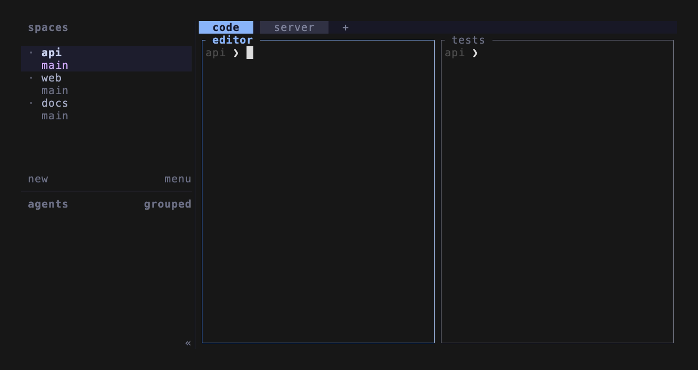

# Helm for Herdr

<p align="center">
  <strong>One popup to reach every workspace, tab, pane, agent, project, and directory in Herdr.</strong>
</p>

<p align="center">
  <a href="https://github.com/black-atom-industries/helm.herdr/actions/workflows/ci.yml"></a>
  <a href="https://github.com/black-atom-industries/helm.herdr/releases/latest"></a>
  <a href="LICENSE"></a>
  
  
</p>



Helm opens on your live session as Workspace → Tab → Pane, and Enter lands on the exact Pane you picked. Press `/` and type, and the same list reaches what is not open yet: zoxide directories, configured roots, Herdr Plus projects, and agents. Helm focuses what exists and creates a Workspace for what does not.

> [!NOTE]
> Part of the [Helm](https://github.com/black-atom-industries) family, next to [helm.tmux](https://github.com/black-atom-industries/helm.tmux). Forked from [thanhdat77/herdr-navigator](https://github.com/thanhdat77/herdr-navigator); thanks to thanhdat77 for the foundation.

## Install

Install the plugin. Herdr clones the repository and builds it with Cargo:

```bash
herdr plugin install black-atom-industries/helm.herdr --yes
```

Link the built binary onto your `PATH`, so a Herdr popup can run it. Run this again after every reinstall, because Herdr may use a new checkout path:

```bash
plugin_root=$(herdr plugin list --plugin helm-herdr --json | jq -r '.result.plugins[0].plugin_root')
mkdir -p "$HOME/.local/bin"
ln -sfn "$plugin_root/target/release/helm-herdr" "$HOME/.local/bin/helm-herdr"
```

Bind it in `~/.config/herdr/config.toml`. The binding owns the key and the popup size:

```toml
[[keys.command]]
key = "prefix+t"
type = "popup"
command = "helm-herdr"
description = "jump to anything"
width = "90%"
height = "90%"
```

## Topology

With an empty Query, every open Workspace is a four-line block: the Workspace, its Tabs, the selected Tab's Panes, and the selected Pane's detail.

| Key                            | Action                                                     |
| ------------------------------ | ---------------------------------------------------------- |
| `l`                            | On a Workspace, step into its Tabs                         |
| `h` / `l`, `Shift-Tab` / `Tab` | On a Tab or Pane, select the previous or next one          |
| `j` / `k`                      | On a Workspace, move between Workspaces; on a Tab or Pane, step down or up a level (`j` on a Pane moves on to the next Workspace) |
| `J` / `K`, `]` / `[`           | Next or previous Workspace, from any depth                 |
| `Enter`                        | Focus the selected Workspace, Tab, or exact Pane           |

The arrow keys mirror `h` `j` `k` `l`.

## Query


Press `/` and type; until then, letters navigate. The topology turns into flat one-line rows, each showing its destination, then its Source and status on the right. A few tokens narrow the match: `agent` or a bare `@` for agents only, `!claude` for an agent name, `@idle` for a Workspace or status, `#idle` for a status alone, `/dotfiles` for a path.

| Row         | Comes from                     | Enter does                                                    |
| ----------- | ------------------------------ | ------------------------------------------------------------- |
| `workspace` | Open Workspaces                | Focus the Workspace                                           |
| `tab`       | Open Tabs                      | Focus the Tab                                                 |
| `pane`      | Open Panes                     | Focus the exact Pane ID                                       |
| `agent`     | Herdr agent panes              | Focus the agent                                               |
| `project`   | Herdr Plus project TOML        | Reuse or create the project Workspace with its tabs and splits |
| `zoxide`    | `zoxide query -l`              | Reuse or create a Workspace there                             |
| `root`      | Configured `[[roots]]`         | Reuse or create a Workspace there                             |
| `quick`     | Herdr Plus Quick Actions       | Open the Quick Actions picker                                 |
| `plugin`    | Your `[[integrations]]`        | Run the integration's open command                            |
| `bookmark`  | Entries marked with `Ctrl-B`, ranked first | Same as the Entry before it was marked             |

The `workspace`, `tab`, and `pane` rows all come from the live session. Each `[sources]` entry in the config can be turned off, and missing optional tools drop out quietly.

| Key              | Action                                                               |
| ---------------- | -------------------------------------------------------------------- |
| `Ctrl-W`         | Workspaces, Tabs, and Panes                                          |
| `Ctrl-A`         | Agents                                                               |
| `Ctrl-P` / `Ctrl-Q` | Herdr Plus projects / Quick Actions                               |
| `Ctrl-Z` / `Ctrl-R` | zoxide / roots                                                    |
| `Ctrl-B`         | Mark or unmark the selected Entry                                    |
| `Ctrl-X`         | Close the open Workspace behind the selected Entry                   |
| `Alt-Enter`      | Open a zoxide or root directory with the shared template             |
| `Ctrl-U`         | Clear the Query and filter                                           |
| `Ctrl-Backspace` | Delete the last Query word                                           |
| `?`              | Show the active keybindings                                          |
| `Esc`            | Leave Search; outside Search, close                                  |
| `Ctrl-C`         | Close                                                                |

`[picker.filter_keys]` remaps the Source shortcuts.

## More moves

### Jump back

Helm records every Workspace focus change, including the ones made with Herdr's own keys, so you can toggle between the current and the previous Workspace like tmux's last-window:

```toml
[[keys.command]]
key = "prefix+l"
type = "plugin_action"
command = "helm-herdr.jump-back"
description = "jump to previous workspace"
```

The previous Workspace also sits at the top of an unfiltered Picker. `[jump_back] pin_previous = false` turns that off, and `enabled = false` stops the recording altogether.

### Side pane

`helm-herdr.open-side` keeps Helm in a split beside your work. It stays open after `Enter`; invoking the action again focuses it, and invoking it while focused closes it.

```toml
[[keys.command]]
key = "prefix+shift+t"
type = "plugin_action"
command = "helm-herdr.open-side"
description = "helm side pane"
```

### Directory template

Point `picker.directory_template` at a Herdr Plus project file, and `Alt-Enter` applies its tabs, panes, labels, and commands to any zoxide or root directory. An already open Workspace gets fresh template tabs appended. `Enter` keeps opening normally.

## Configuration

Helm writes a commented config on first run, in the directory this prints:

```bash
herdr plugin config-dir helm-herdr
```

[`examples/default-config.toml`](examples/default-config.toml) documents every option. A typical start:

```toml
[picker]
source_order = ["workspace", "agent", "project", "zoxide", "root", "quick", "plugin"]
# directory_template = "default.toml"

[theme]
# Follow Herdr's palette, including auto-switching light/dark themes.
inherit_herdr = true

[sources]
zoxide = true
roots = true

[[roots]]
path = "~/code"
max_depth = 2
```

Helm checks GitHub for a new release at most once a day. When one exists, the header shows a badge, and `F5` installs it through Herdr. `picker.check_updates = false` turns that off.

## Add your own source

An integration needs a command that lists items as JSON and a command that opens one:

```toml
[[integrations]]
id = "bookmarks"
label = "Bookmarks"
enabled = true
collect = "bookmarks list --json"
open = "bookmarks open {{id}}"
```

`collect` prints an array of `{ "id", "title", "subtitle", "path", "kind" }` objects. Helm shell-quotes each `{{field}}` before running `open`. [`docs/plugin-integrations.md`](docs/plugin-integrations.md) has the full contract.

## Requirements

- Herdr 0.7.4 or newer, on Linux or macOS
- `jq` for the install link command
- Optional: `zoxide` for directory history, Herdr Plus for projects and Quick Actions
- Rust stable, only when building from source

## Build from source

```bash
git clone https://github.com/black-atom-industries/helm.herdr.git
cd helm.herdr
mise run git:config
lefthook install
./scripts/install-local.sh
```

`install-local.sh` builds the release binary, links it to `~/.local/bin/helm-herdr`, and registers the checkout with `herdr plugin link`, so a rebuild takes effect without reinstalling. [`CONTRIBUTING.md`](CONTRIBUTING.md) covers the development workflow.

## Troubleshooting

Check that Herdr sees the plugin:

```bash
herdr plugin list
herdr plugin action list --plugin helm-herdr
```

Print every collected Entry without opening the TUI:

```bash
helm-herdr list
```

When the key does nothing, check that `helm-herdr` is on `PATH` and reload Herdr's config:

```bash
command -v helm-herdr
herdr server reload-config
```

## Docs

- [`docs/index.md`](docs/index.md): architecture, integrations, the plugin contract, and releases
- [`CHANGELOG.md`](CHANGELOG.md): release notes
