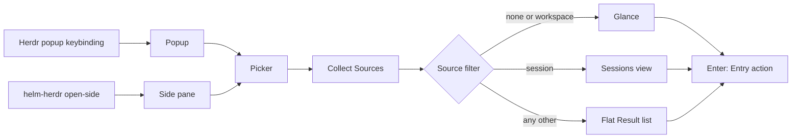
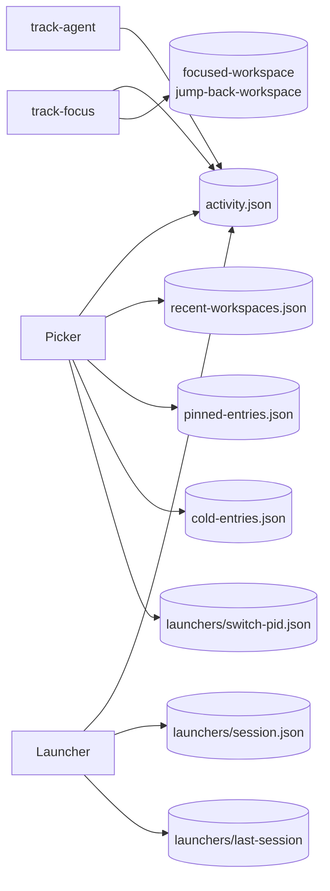
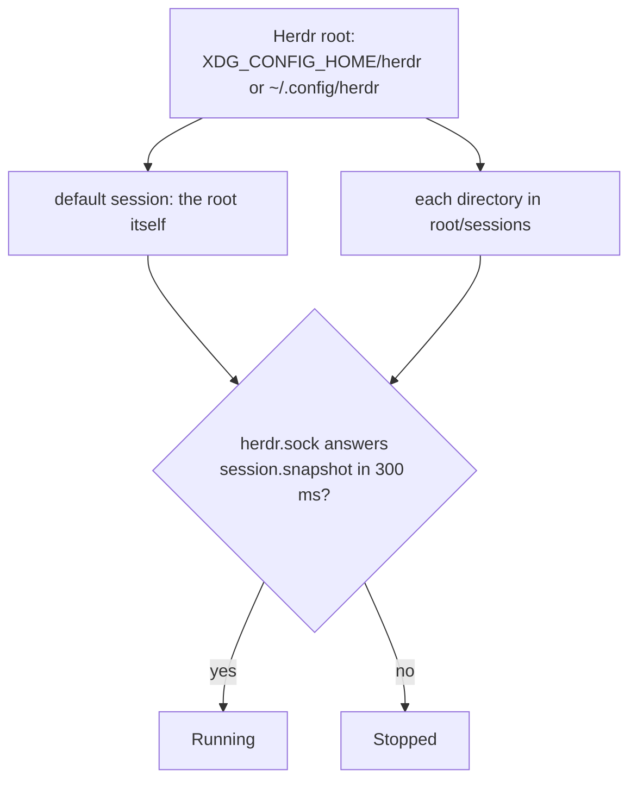
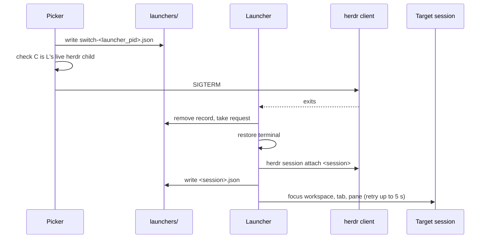
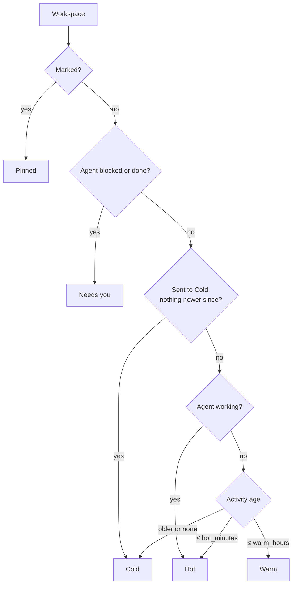

# Architecture

Helm is one Picker for Herdr destinations and actions. It runs in a Popup from a Herdr keybinding, or in a persistent Side pane.

## Runtime



The Popup's size belongs to the user's Herdr keybinding. The Side pane is a Herdr split: `open-side` opens it when absent, focuses it when unfocused and closes it when focused. Enter leaves it open.

## Entry points

| Command | Purpose |
| --- | --- |
| `helm-herdr` (or `ui`) | Run the Picker |
| `helm-herdr open` | Ask Herdr to open the configured Popup |
| `helm-herdr open-side` | Toggle the Side pane |
| `helm-herdr list` | Print the collected Entries |
| `helm-herdr status` | One line for Herdr's tab bar: other sessions with Workspaces in Needs you |
| `helm-herdr shell [session]` | The Launcher: runs a Herdr client and attaches another session on request |
| `helm-herdr track-focus` | Hook for `workspace.focused` (reads `data.workspace_id`) |
| `helm-herdr track-agent` | Hook for `pane.agent_status_changed` (reads `data.pane_id`, `data.agent_status`) |

Herdr runs the two hooks from `herdr-plugin.toml` and passes the event in `HERDR_PLUGIN_EVENT_JSON`.

## State

All state lives in the plugin config directory, `HERDR_PLUGIN_CONFIG_DIR`.



| File | Holds |
| --- | --- |
| `activity.json` | Workspace focus times, Pane agent status changes, when the User was last in each session |
| `recent-workspaces.json` | Workspace IDs per session, most recent first |
| `focused-workspace`, `jump-back-workspace` | The last focused and the Previous workspace |
| `pinned-entries.json` | Marked Entries (Pinned group) |
| `cold-entries.json` | Entry key → Unix seconds when sent to Cold. A plain array of keys reads as sent at 0 |
| `launchers/<session>.json` | The live Launcher of a session: `launcher_pid`, `client_pid`, `session` |
| `launchers/switch-<launcher_pid>.json` | A switch request: `session`, optional `workspace_id`, `tab_id`, `pane_id` |
| `launchers/last-session` | The session the last Launcher ran, written on a clean exit, a signal or a switch |

```json
{
  "version": 1,
  "workspaces": { "work::w1": { "focused_at": 1792931924 } },
  "panes": { "work::w1:p1": { "status": "working", "since": 1792931924 } },
  "sessions": { "work": { "seen_at": 1792931924 } }
}
```

- Keys are `<session>::<herdr id>`, with `<default>` for the default session, because Herdr IDs repeat across sessions.
- Times are Unix seconds. `since` changes only when the status changes.
- `seen_at` is set by `track-focus`, by opening the Picker and by the Launcher on attach and exit. Without it, a session falls back to its newest `focused_at`.
- Opening the Picker prunes the current session's missing Workspaces and Panes. It skips pruning on an empty Topology.
- Every write takes a lock on `activity.json.lock`, then replaces the file through a rename.

## Herdr sessions



Sockets are probed in parallel. The current session is `HERDR_SESSION`, unset for the default one.

### Other sessions in the Glance

On each load (at open and on the 3 s refresh), Helm reads every other running session. The Glance keeps only Workspaces with a blocked or done agent; the others stay search-only and show up under a `*` query. Herdr keeps focus per session, so an agent that finishes in a session you left reads idle. An idle agent whose `since` is newer than that session's `seen_at` therefore counts as done.

| Aspect | Behavior |
| --- | --- |
| Row | `@<session>` tag, header adds `· M elsewhere`, footer shows `enter switch to <session>` |
| Reads | No git or transcript reads |
| Pin, Cold, close | Ignored, since IDs repeat across sessions |
| Current, Previous | Never |
| No live Launcher | Picker stays open with `Start Herdr with helm-herdr shell to switch sessions` |

### Sessions view

Running sessions list the current one first, then by newest activity. Stopped sessions follow. A row shows the most urgent agent state, `N need you`, the Workspace count (`start` when stopped) and the age of the newest activity. The detail pane groups the session's Workspaces like the Glance, without Pinned, and numbers the first nine. Git for other sessions comes from a background read, kept 30 s.

`helm-herdr status` uses the same reads without git and prints `<session> <icon><count>` per session, empty when nothing waits. It always exits 0.

### Switching sessions



| Opened from | Target |
| --- | --- |
| Glance row, `enter` or label twice | That Workspace, at the waiting agent's Tab and Pane |
| Glance row, `1`–`9` | That Workspace and Tab |
| Sessions view, `enter` or label twice | The session's last focused Workspace, if known |
| Sessions view, `1`–`9` | That numbered Workspace; on the current session, focus it here |
| `l` | Another session's Workspace when it was focused more recently than any local one |

The rules:

- `shell` attaches its argument, else `last-session`, else `default`. It refuses an empty name, a name with `/` or `..`, or one starting with `switch-` (exit 2).
- The Launcher ignores SIGINT while its client runs, because the client reads Ctrl-C as a key.
- A record is live while its `client_pid` is a process named `herdr` whose parent is the Launcher, so the Herdr binary must be named `herdr`. A stale record withdraws the request.
- On restore, the Launcher runs `stty sane` and resets cursor, mouse, paste, focus and kitty keyboard modes. It leaves the alternate screen only before a switch or after a signal, so a client's parting message stays visible.
- One record per session, last writer wins. Herdr has no client-detach API, and the session server keeps running.

## Code layout

```text
src/main.rs       CLI entrypoints and popup/Side requests
src/app.rs        Picker state, Query projection, filtering, and Entry actions
src/tui.rs        terminal UI and command execution
src/keymap.rs     key registry, labels, groups, and active states
src/activity.rs   activity.json state and event payload parsing
src/config.rs     plugin config loading and defaults
src/model.rs      Source/Entry/EntryAction models
src/sources.rs    source collectors
src/glance.rs     glance grouping, row signals, ages and status icons
src/detail.rs     detail pane git reads and Claude subagent transcripts
src/topology.rs   live Workspace/Tab/Pane model and Git identity
src/herdr.rs      Herdr CLI and socket calls
src/sessions.rs   session discovery, other sessions' snapshots, Launcher records and switch requests
src/launcher.rs   helm-herdr shell: attach loop, terminal restore and focus after a switch
src/recent.rs     recent Workspace order and the Previous workspace per session
src/paths.rs      Herdr root, plugin config and state file paths
src/matcher.rs    Query matching engines
src/theme.rs      palette, inherited from Herdr when enabled
src/update.rs     GitHub release check and update install
src/integrations/ built-in Herdr Plus adapter and command integrations
```

## Query

| Source filter | View | A Query |
| --- | --- | --- |
| none or `workspace` | Glance | narrows rows in place, keeps groups, adds Directories and Other groups |
| `session` (`^S`) | Sessions view | narrows by session name |
| any other | Flat Result list, `destination \| Source \| status` | narrows the list |

| Token | Matches |
| --- | --- |
| `agent` | Entries with an agent |
| `!name` | agent names |
| `@text` | Workspace or status text |
| `/path` | paths |
| `#status` | status text |
| `*`, `*name` | Workspaces of every session, or of sessions named like `name` |

Plain text matches only what a row shows. With the nucleo engine, a row stays while its score reaches 85% of the best visible one. Queries of tokens only keep every match. The cursor follows the best match until you move it.

## Glance



Activity is the newest of the Workspace's focus time, its last commit and its newest agent status change that still matches the live state. Rows sort by newest activity at open. After that, a refresh keeps every row and label in place. A row moves only when it changes group, and new rows join the end of their group.

| Read | When | Kept |
| --- | --- | --- |
| Herdr snapshot and activity | every 3 s, background | |
| Git identity and `git status --porcelain=v2 --branch` | at open, then every 30 s | |
| Detail changes and commits (`status`, `diff --numstat`, `log`) | on selection, background | 10 s |
| Claude subagent transcripts in `~/.claude/projects` | with the detail pane | read only |

- **GIT column:** `+n !n ?n ↑n ↓n` without zero parts, `✓` when clean, at most 12 cells.
- **Detail pane:** shown at 110+ columns and takes 45% of the width. It shows name, branch, path, Tab chips, agents, changes and commits.
- **Subagents:** shown under their agent with a `PROGRESS: n/m` bar. A subagent counts as finished on a stop without a tool call, a `SubagentHandback` result or an interruption. After 10 minutes untouched it counts as abandoned.
- **Progress column:** sums the running subagents into 8 cells, only while an agent works.

## Keys and Enter actions

| Source | Enter action |
| --- | --- |
| `workspace` | Focus the Workspace by ID, or the waiting agent's Pane when it needs you |
| `session` | Switch to that session, or return to the Glance on the current one |
| `zoxide` / `root` | Reuse or create a directory Workspace; `Alt-Enter` applies the directory template |
| `quick` | Open the Herdr Plus Quick Actions picker |
| `plugin` | Run the integration's open command |
| `bookmark` | Apply the marked Entry's underlying action |

| Key | Action |
| --- | --- |
| `j` `k`, Up Down | Move across groups |
| label (`asdfg`) | Select the row. Twice opens it, label then digit opens that Tab |
| `1`–`9` | Open that Tab of the selected Workspace |
| `]` / `[` | Next group / start of this or the previous group |
| `!` | Next row that needs you, Pinned included |
| `l` | Previous workspace, or a more recent one in another session |
| `^S` | Sessions view |
| `*` | Search with a `*` query |
| `tab` / `Shift-tab` | Next / previous source in the strip |
| `x` `x`, `^X` | Close the Workspace |
| `c` `c`, `c` on a cold row | Send to Cold, warm up |
| `Shift-J` `Shift-K` | Scroll the detail pane |
| `q` | Close Helm |

Helm opens on the Current workspace. Labels never use `c`, `j`, `k`, `l`, `q` or `x`, and Search mode hides them.

## Boundaries

- **Herdr Plus:** directory templates read Herdr Plus project TOML for tabs and splits, and the Quick Action Entry delegates to it. It is built in because it needs Workspace and Tab bootstrap. Helm works without it.
- **Integrations:** use the command/JSON contract in [`plugin-integrations.md`](plugin-integrations.md).
- **Config:** [`examples/default-config.toml`](../examples/default-config.toml) lists every key with its default.
- **Colors:** `[theme] inherit_herdr` takes the palette from Herdr's theme, falling back to Catppuccin. Off, Helm uses One Light.

## Design goals

- One Picker for Herdr destinations and actions.
- Exact Herdr identity: Workspace, Tab and Pane rows address by ID, since two Workspaces can share a cwd. Only directory rows match by cwd.
- Optional Sources degrade quietly.
- A small Rust binary with no external Picker dependency.
